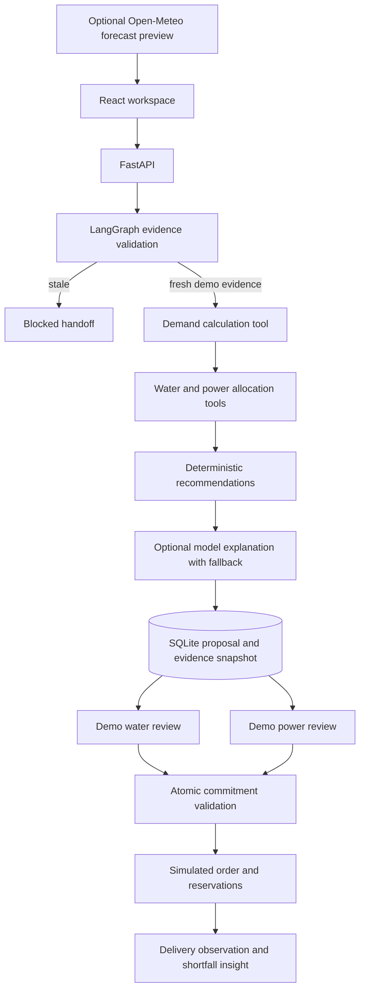

# JalaSetu project framework

## Overview

JalaSetu helps irrigation and electricity planners turn village crop-water requirements into a coordinated, auditable release and pumping proposal in a React workspace. The prototype gathers a local evidence snapshot, calculates demand and physical constraints, generates insights, hands off for separate water and power reviews, and records delivery observations. It demonstrates a complete decision workflow using synthetic data.

## Agent framework

| Field | Implementation |
| --- | --- |
| Goal | Produce a reviewable water and lift-power proposal that protects configured reserves and identifies unmet village needs. |
| Users and surface | Irrigation planner, demo water reviewer, demo power reviewer and farmer-support analyst in a local React web application. |
| Steps | Validate evidence → calculate demand → allocate within water/power/canal constraints → explain and save → wait for reviews → reserve simulated order → observe delivery. |
| Tools | Reservoir ledger read, village registry read, crop-demand calculator, water/power allocator, optional weather HTTP adapter and optional LLM explanation. State writes save proposals, reviews and delivery observations locally; no external control writes exist. |
| Memory | SQLite retains the evidence dataset, scenario input, calculation output, source hash, decisions, reservations, audit entries and cumulative deliveries across restarts. |
| Boundaries | Never invent a live reading or treat a demo reviewer as an authenticated official. Never operate a gate or pump, send an official order, or claim full Telangana coverage. |
| Human review | Separate water and power approval gates. Rejection ends a proposal; recalculation makes a new ID. Changed or expired evidence and competing commitments block approval. |
| Failure recovery | Stale observations route to blocked handoff. Weather has two attempts and manual fallback. Optional LLM failure keeps deterministic results. Power failure disables lift delivery while eligible gravity routes continue. |
| Success target | A reviewer can complete the synthetic planning-to-delivery workflow in under five minutes, while all invariant and failure tests pass. This is a target; no measured user study is claimed. |

## Architecture

The base graph controls calculations and stale-evidence handoff. A second supervisor graph conditionally invokes weather, water calculation, bounded power comparisons and a Kaleshwaram capacity tool. SQLite LangGraph checkpoints preserve its state; a real interrupt pauses at analysis review and resumes before recalculating and saving a proposal. Separate water and power approvals remain transactional application states. Optional model output is restricted to explanation; deterministic rules choose tools and enforce numerical constraints.

## Datasets and integrations

The dataset contains eight named reservoir fixtures and sixteen fictional village records. All readings, source-route assignments, reserve volumes and engineering values are synthetic. The seed timestamp is a demo-generation timestamp. Names provide Telangana context without implying verified command-area connectivity.

Open-Meteo is implemented as an optional live preview adapter. Forecast success depends on external network access; weather is not automatically applied to planning. Optional model credentials are supplied through server environment variables; no successful model invocation is claimed without those credentials. The preceding reservoir and API research is in `research/RESEARCH.md`.

## Implementation prompts and iterations

The build followed the user's requests to track water from reservoir to field, protect drinking water, calculate electricity from irrigation needs, provide crop-demand recommendations, require official-style reviews, and implement the interface using React. The implementation began with deterministic calculation tools and separate review gates; the interface was then changed to React after the user's explicit preference.

Subsequent iterations added actual pump-window capacity and travel-time checks, power-window comparison, source-water reservation transactions, changed-evidence invalidation, daily schedules, blocked duplicate route scheduling and delivery-shortfall prompts. These reflect why a reservoir-storage dashboard alone is insufficient.

## Demonstration script under five minutes

- 0:00–0:45: Explain the goal and the synthetic-data boundary. Show the reservoir and registered-village summary.
- 0:45–1:45: Change demand and compare power windows. Explain why drinking-water reserves and canals can remain binding.
- 1:45–2:45: Generate a proposal and inspect the calculation trail, release ledger and village delivery/power plan.
- 2:45–3:45: Record separate demo water/power reviews, then a partial delivery observation and inspect the audit history.
- 3:45–4:30: Demonstrate stale-evidence handoff and power-outage recovery. Refresh to show durable state.
- 4:30–5:00: Describe the React/Python/LangGraph tools, the role of AI coding assistance, verification results and what real deployment needs.

## Additional features in priority order

1. **Verified data first:** official reservoir bulletins, command-area topology, village registry, crop stages and measured outlet/feeder observations, each with provenance and observation time.
2. **Government identity:** authenticated roles, jurisdiction-scoped access, engineer-reviewed operating rules, signed proposal versions, approval expiry and reconciled commitment changes.
3. **Shared network model:** canal/feeder capacity, multiple lift stages, balancing tanks, reservoir cascades, travel time, losses, evaporation and upstream uncertainty. Co-optimize water delivery and electricity schedules.
4. **Drinking-water planning:** service-area populations, locally approved per-capita demand, treatment/conveyance losses, drought reserve horizon and alternative supply options.
5. **Farmer guidance:** Telugu text/voice, verified release announcements, crop-stage alerts and agronomist-reviewed lower-water alternatives with soil, market and procurement suitability.
6. **Forecasts and uncertainty:** rainfall ensembles, soil-water balance, inflow scenarios, groundwater/tank observations, backtests and uncertainty ranges instead of a single precise forecast.
7. **Hydropower coordination:** flow routed through turbines into downstream reservoirs; head-dependent energy and minimum levels without double counting irrigation water as consumed by generation.
8. **Equity and outcomes:** tail-end delivery, tenancy and small-farm access, village service levels, water productivity and costs. Validate that stage-based priorities do not create systematic exclusion.

## Learnings and limits

More pumping power can improve delivery only where source water and hydraulic capacity permit it. A release approval is meaningful only if its evidence version, delivery route and power plan are explicit. Independent demo pools cannot stand in for an interconnected basin, and an LLM's fluency cannot validate a storage reading. This prototype makes those boundaries visible while demonstrating the end-to-end workflow.

## Submission assets

The folder includes runnable source, tests, a prebuilt React bundle, dataset generation, research and this project documentation. This Markdown file can be used to prepare the required Google Doc. No Google Doc, demo video, GitHub repository or course-form submission has been created by this build.

## Farmer support extension

The Farmer & alerts screen converts acres and supplemental application depths into a water volume and pump duration. Verified effective rain reduces the requirement, while forecast rain can request a review before irrigation. A village rain event is separately scoped to the fictional village and changes subsequent plans. Feeder outages zero affected lift allocations, and new events invalidate pending review.

Utility-window and feeder observations generate in-app farmer updates, unexpected-outage escalations and uncertainty notices. The release monitor compares user-entered demo meter rates and cumulative volumes against demo approval thresholds and avoids repeated high-state alerts. No external SMS, WhatsApp or voice message is sent; production requires opt-in contacts, provider integration and continuously authenticated telemetry.

## Visual design revision

JalaSetu now has an independent marine-blue visual system with white navigation, an ice-blue canvas and sans-serif headings. A persistent workflow strip displays saved agent tool steps and the actual human-review state; the overview launches the durable supervisor. Idle and persisted states are labelled explicitly rather than presented as a continuously running agent.
