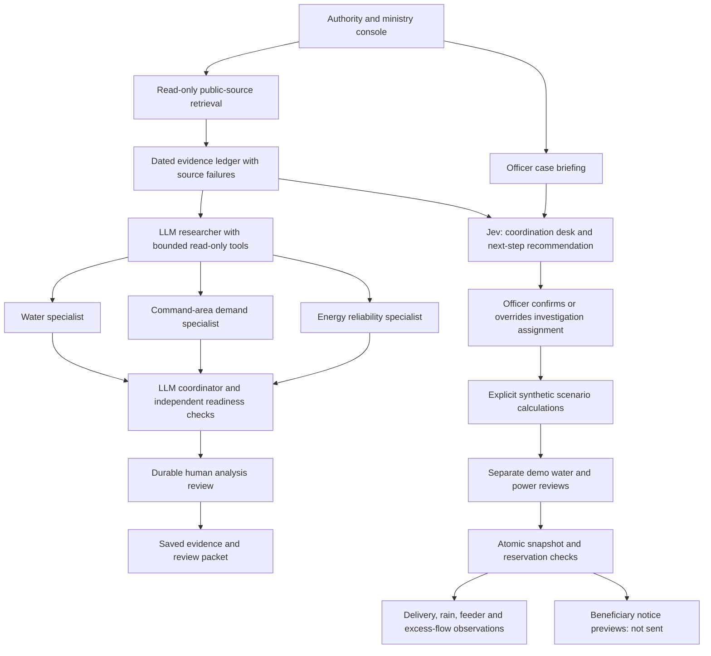

# JalaSetu project framework

JalaSetu supports irrigation authorities, reservoir operators, power coordinators and ministry officials. Farmers and village communities are beneficiaries of authority-issued schedules and advisories, without logging in. The prototype connects public evidence, departmental coordination, scenario analysis, human reviews and delivery oversight.

## Architecture

Arrows from assignments to scenario planning express the operator's next workflow step. Jev does not execute tools, automatically change screens, issue orders or send communications. Officers choose those actions. The research graph has a researcher, three parallel specialist model calls and a synthesis model call: five roles, with up to three researcher turns and six executed tools. Missing model credentials stop this graph after fetching evidence; there is no fabricated model completion. Specialist schema and evidence references are checked; citations alone do not establish factual correctness.

The academy's deal-review example provides useful patterns: tool use, parallel specialist review, deterministic checks, synthesis, human interruption and a final report. JalaSetu adapts those patterns to public water and power evidence. It does not treat reproducibility as 100% confidence or SQLite as a tamper-proof audit system.

## Authority responsibilities

| User | Decision support |
| --- | --- |
| Ministry oversight | Reservoir evidence coverage, unresolved cases, missing operational data and scenario review status |
| Reservoir operations | Dated levels/storage definitions, protected-pool scenarios and release ledgers |
| Irrigation planning | Command demand, crop stage, rain-adjusted supplemental needs, canal constraints and shortfalls |
| Power coordination | Lift energy and hours, utility confirmation gaps, outages and replan advisories |
| Water/power reviewers | Separate review gates against the exact saved simulation snapshot |
| Field officers | Rain, feeder and delivery observations; excess-release alerts; beneficiary notice preparation |

No production authentication or legal signing is implemented. Demo reviewer names demonstrate workflow only. A production deployment requires government identity, role permissions, command-area inventory, engineering constraints, current legal orders, reconciled telemetry and utility agreements.

## Evidence and model access

Public collectors request official NPP report links dynamically, parse report rows with units/dates/pages, try KRMB, retrieve modelled weather and optionally collect an explicitly secondary storage observation. Authentication failures, timeouts and unavailable measurements are recorded. Tavily is optional discovery, not measurement validation.

A separate TypeSafe key enables Jev's narrow authority-routing judgments. OpenAI or a supported compatible provider with an exact model ID enables the five research roles. Credentials entered in Connections are process-memory only. Without credentials, deterministic tools, public evidence, manual case assignment and the scenario review demonstration remain available.

## Validation and limits

Tests cover water conservation, protected reserves, energy/deadline constraints, stale/changed evidence, independent reviews, competing reservations, delivery validation, rain/feeder event handling, durable graph review, provider failure visibility, PDF measurement definitions, Jev response validation, manual triage and beneficiary previews. Paid-provider calls are mocked in tests; real model accuracy, Telugu routing, cost and latency need a labelled domain evaluation.

Operating parameters remain explicitly synthetic because public report rows alone do not establish command connectivity, protected reserves, legal availability, shared canal limits or feeder commitments. Real public evidence is displayed separately. The application supports investigation and review; it does not authorize or actuate a real release.
